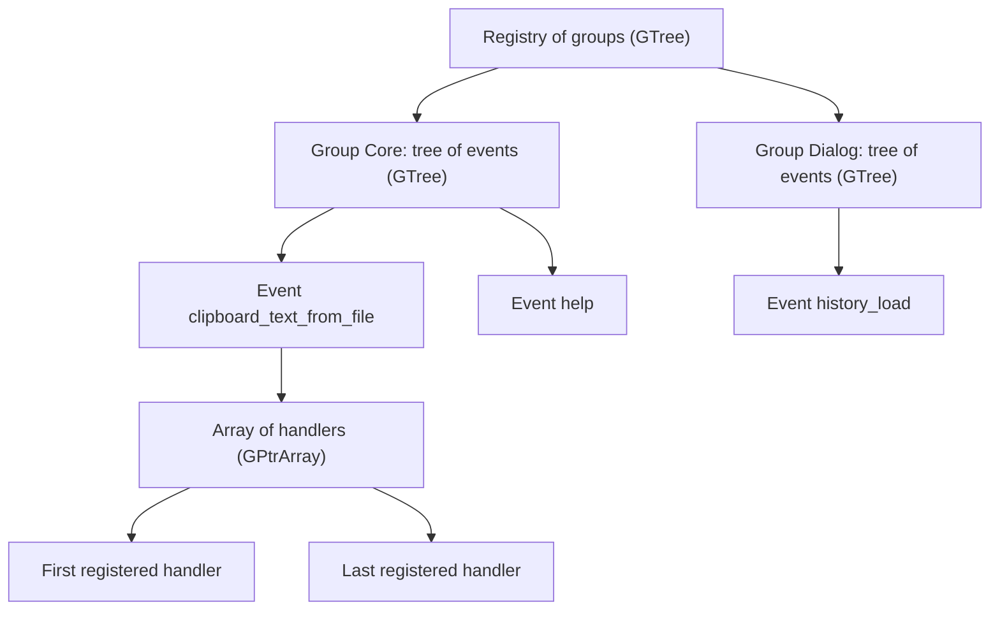

# The bluerig event system

`lib` has an event system. For example, an input field asks for the text of
the clipboard by raising `Core:clipboard_text_from_file`. A handler from
[src/clipboard.c](../../src/clipboard.c) reads the file.

An event is named by a group name and an event name. Both names are looked up
ignoring the case of Latin letters. An event can have several handlers.

## The registry



Every event has its own array of handlers.

## Registering and raising

The API is declared in [lib/event.h](../event.h). At start `events_init()` from
[src/events_init.c](../../src/events_init.c) calls `mc_event_init()` and
registers the standard handlers.

| Function | Description |
| --- | --- |
| `mc_event_add()` | Registers a handler and an `init_data` pointer. Registering the same pair of pointers again adds no handler and does not change the call order. |
| `mc_event_mass_add()` | Registers the handlers of an `event_init_t` array. The last entry has NULL in `event_group_name`. On an error the handlers already added stay. |
| `mc_event_raise()` | Calls the handlers synchronously. Returns TRUE if the event is found, also when its list of handlers is empty or one of them stopped the call. |
| `mc_event_present()` | Checks whether the event is in the registry. |
| `mc_event_del()` | Removes the registration of a pair of handler and `init_data`. The entry of the event stays in the registry. |
| `mc_event_destroy()` | Removes the event with all its handlers. |
| `mc_event_group_del()` | Removes the group with all its events. |
| `mc_event_deinit()` | Frees the event registry. |

`mc_event_init()`, `mc_event_add()` and `mc_event_mass_add()` take a
`GError **`: on an error they return FALSE and fill it. `events_init()`
passes the error on, and the program does not start.

Raising an event, as the input field in
[lib/widget/input.c](../widget/input.c) does it:

```c
char *text = NULL;
ev_clipboard_text_from_file_t event_data = { &text, FALSE, 0 };

mc_event_raise (MCEVENT_GROUP_CORE, "clipboard_text_from_file", &event_data);
if (event_data.ret && text != NULL)
{
    // event_data.len bytes of text; the caller frees the text
    g_free (text);
}
```

## The handler

```c
static gboolean
handle_event (const gchar *event_group, const gchar *event_name,
              gpointer init_data, gpointer event_data);
```

| Parameter | Description |
| --- | --- |
| `event_group` | The group name given to the call. |
| `event_name` | The event name given to the call. |
| `init_data` | The pointer given when the handler was registered. |
| `event_data` | The pointer given to `mc_event_raise()`. |

The last registered handler is called first. If it returns TRUE, the call
goes on. FALSE stops the call of the remaining handlers.

The data structures of the standard events are declared in
[lib/event-types.h](../event-types.h). The caller passes a pointer to a
structure of the right type. The handler reads the input fields and fills the
result fields if needed. For example, `clipboard_text_from_file` writes the
text, its length and a success flag into `ev_clipboard_text_from_file_t`. The
type of the pointer is not checked at the call. The event system keeps
`init_data` until the registration is removed. The code that registered the
handler controls the lifetime of the object behind this pointer.

## A new event

1. Declare the data structure of the event in
   [lib/event-types.h](../event-types.h), with a `group:name` comment above
   it, as for `ev_clipboard_text_from_file_t`. An event without data needs no
   structure: the caller passes NULL.
2. Take the group name from the constants `MCEVENT_GROUP_CORE` and
   `MCEVENT_GROUP_DIALOG` or set your own; the event name is a string.
3. Register the handler: with an entry in `standard_events` in
   [src/events_init.c](../../src/events_init.c) if it is permanent, or with
   `mc_event_add()` where its code lives. Remove it with `mc_event_del()`
   while the object behind `init_data` is alive.
4. The caller fills the structure and calls `mc_event_raise()`, as in the
   example above.

## Limits

- The registry has no locks: events are registered and raised from one
  thread, the main loop of the program.
- Do not register or remove handlers of an event from inside a handler of
  the same event. `mc_event_raise()` walks the array of handlers by index,
  and a change of the array during the walk skips a handler, calls one
  twice or goes past the end of the array.

## Events and plugin services

Plugins talk to each other not with events but with services from
[lib/plugin-service.h](../plugin-service.h): a service has a name, methods
with GVariant arguments and signals that subscribers receive. The build,
coverage and project plugins work this way. Events connect parts of the core:
the widgets of `lib` and the program code of `src`.

## Logging

To see when an event is raised, add a temporary handler to
[src/events_init.c](../../src/events_init.c). Include `lib/logging.h` and
define the function:

```c
static gboolean
log_event (const gchar *event_group, const gchar *event_name,
           gpointer init_data, gpointer event_data)
{
    (void) init_data;
    (void) event_data;

    mc_log ("Event: %s:%s\n", event_group, event_name);
    return TRUE;
}
```

Add an entry to `standard_events` after the standard
`clipboard_text_from_file` handler and before the closing NULL entry:

```c
{ MCEVENT_GROUP_CORE, "clipboard_text_from_file", log_event, NULL },
```

Run bluerig with `BLUERIG_LOG_ENABLE=1`. The handler writes the event name
before the clipboard is read and returns TRUE so that the call goes on.
