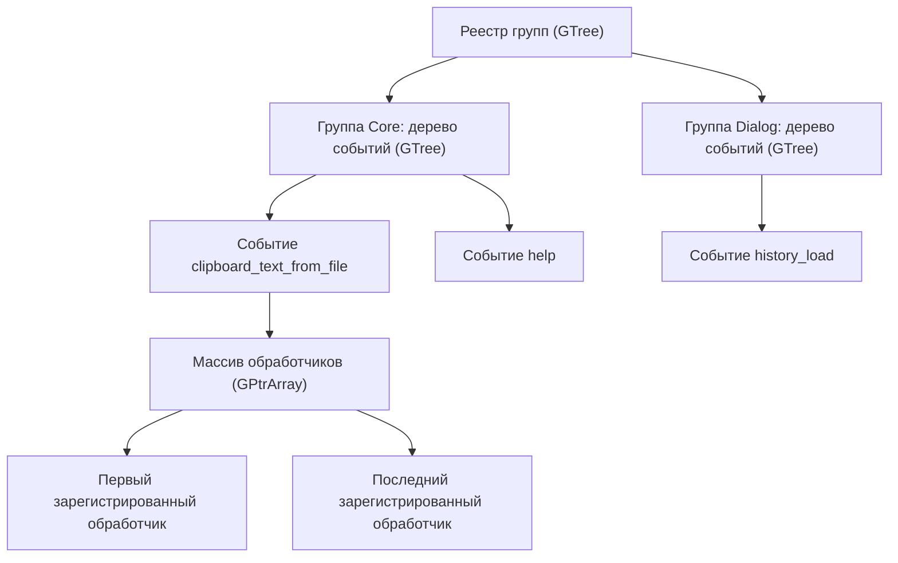

# Система событий bluerig

В `lib` реализована система событий. Например, поле ввода запрашивает текст
буфера обмена, вызывая `Core:clipboard_text_from_file`. Чтение файла выполняет
обработчик из [src/clipboard.c](../../src/clipboard.c).

Событие определяется именем группы и именем события. При поиске обоих имён
регистр латинских букв игнорируется. У события может быть несколько
обработчиков.

## Устройство реестра



У каждого события свой массив обработчиков.

## Регистрация и вызов

API объявлен в [lib/event.h](../event.h). При запуске `events_init()` из [src/events_init.c](../../src/events_init.c)
вызывает `mc_event_init()` и регистрирует стандартные обработчики.

| Функция | Описание |
| --- | --- |
| `mc_event_add()` | Регистрирует обработчик и указатель `init_data`. Повторная регистрация той же пары указателей не добавляет обработчик и не меняет порядок вызова. |
| `mc_event_mass_add()` | Регистрирует обработчики из массива `event_init_t`. Последняя запись содержит NULL в `event_group_name`. При ошибке уже добавленные обработчики остаются. |
| `mc_event_raise()` | Вызывает обработчики синхронно. Возвращает TRUE, если событие найдено, в том числе если список обработчиков пуст или один из них остановил вызов. |
| `mc_event_present()` | Проверяет, есть ли событие в реестре. |
| `mc_event_del()` | Снимает регистрацию по паре обработчик и `init_data`. Запись о событии остаётся в реестре. |
| `mc_event_destroy()` | Удаляет событие со всеми его обработчиками. |
| `mc_event_group_del()` | Удаляет группу со всеми её событиями. |
| `mc_event_deinit()` | Освобождает реестр событий. |

`mc_event_init()`, `mc_event_add()` и `mc_event_mass_add()` принимают
`GError **`: при ошибке возвращают FALSE и заполняют её. `events_init()`
передаёт ошибку дальше, и программа не запускается.

Вызов события, как его делает поле ввода в
[lib/widget/input.c](../widget/input.c):

```c
char *text = NULL;
ev_clipboard_text_from_file_t event_data = { &text, FALSE, 0 };

mc_event_raise (MCEVENT_GROUP_CORE, "clipboard_text_from_file", &event_data);
if (event_data.ret && text != NULL)
{
    // event_data.len байт текста; текст освобождает вызывающий код
    g_free (text);
}
```

## Обработчик

```c
static gboolean
handle_event (const gchar *event_group, const gchar *event_name,
              gpointer init_data, gpointer event_data);
```

| Параметр | Описание |
| --- | --- |
| `event_group` | Имя группы, переданное при вызове. |
| `event_name` | Имя события, переданное при вызове. |
| `init_data` | Указатель, переданный при регистрации обработчика. |
| `event_data` | Указатель, переданный в `mc_event_raise()`. |

Первым вызывается последний зарегистрированный обработчик. Если он
возвращает TRUE, вызов продолжается. FALSE останавливает вызов оставшихся
обработчиков.

Структуры данных стандартных событий объявлены в [lib/event-types.h](../event-types.h). Вызывающий
код передаёт указатель на структуру нужного типа. Обработчик читает входные
поля и при необходимости заполняет поля результата. Например,
`clipboard_text_from_file` записывает в `ev_clipboard_text_from_file_t` текст,
его длину и признак успешного чтения. Тип указателя при вызове не проверяется.
Система событий хранит `init_data` до снятия регистрации. Время жизни объекта
по этому указателю контролирует код, который зарегистрировал обработчик.

## Новое событие

1. Объявите структуру данных события в [lib/event-types.h](../event-types.h),
   с комментарием `группа:имя` над ней, как у
   `ev_clipboard_text_from_file_t`. Событию без данных структура не нужна:
   вызывающий код передаёт NULL.
2. Имя группы берите из констант `MCEVENT_GROUP_CORE` и
   `MCEVENT_GROUP_DIALOG` или задайте своё; имя события - строка.
3. Зарегистрируйте обработчик: записью в `standard_events` в
   [src/events_init.c](../../src/events_init.c), если он постоянный, или
   вызовом `mc_event_add()` там, где живёт его код. Снимите его через
   `mc_event_del()`, пока жив объект по `init_data`.
4. Вызывающий код заполняет структуру и вызывает `mc_event_raise()`, как в
   примере выше.

## Ограничения

- Реестр не защищён блокировками: события регистрируются и вызываются из
  одного потока, основного цикла программы.
- Не регистрируйте и не снимайте обработчики события изнутри его же
  обработчика. `mc_event_raise()` обходит массив обработчиков по индексу, и
  изменение массива во время обхода приводит к пропуску обработчика,
  повторному вызову или выходу за границы массива.

## События и сервисы плагинов

Плагины связываются между собой не событиями, а сервисами из
[lib/plugin-service.h](../plugin-service.h): у сервиса есть имя, методы с
аргументами в GVariant и сигналы, которые получают подписчики. Так работают
плагины build, coverage и project. События связывают части ядра: виджеты
из `lib` и код программы из `src`.

## Журналирование

Чтобы увидеть, когда вызывается событие, добавьте в [src/events_init.c](../../src/events_init.c)
временный обработчик. Подключите `lib/logging.h` и определите функцию:

```c
static gboolean
log_event (const gchar *event_group, const gchar *event_name,
           gpointer init_data, gpointer event_data)
{
    (void) init_data;
    (void) event_data;

    mc_log ("Event: %s:%s\n", event_group, event_name);
    return TRUE;
}
```

Добавьте запись в `standard_events` после стандартного обработчика
`clipboard_text_from_file` и до завершающей записи с NULL:

```c
{ MCEVENT_GROUP_CORE, "clipboard_text_from_file", log_event, NULL },
```

Запустите bluerig с `BLUERIG_LOG_ENABLE=1`. Обработчик запишет имя события
перед чтением буфера обмена и вернёт TRUE, чтобы вызов продолжился.
